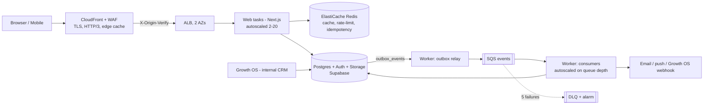

# Gearbox — System Design

Gearbox is a two-sided marketplace for camera-gear rental. The design goal for MVP → seed:
**correctness of money and inventory first, horizontal scale second, and no re-architecture
needed to reach ~1M MAU.**

## 1. Requirements

| | |
|---|---|
| **Functional** | Browse/search catalog · availability calendar · book gear · owner approval · notifications · waitlist/CRM |
| **Non-functional** | Read-heavy (~100:1), spiky · no double-booking, ever · retry-safe writes · p95 < 300 ms catalog reads · survive loss of one AZ |

## 2. High-level architecture

## 3. Key decisions

**Stateless web tier.** Auth is a Supabase JWT verified per request, so any replica serves any
request: autoscaling, rolling deploys and AZ failover are trivial.

**Three-layer read path.**
1. CloudFront: `/_next/static/*` cached a year; `/api/v1/equipment*` honours `s-maxage=60, stale-while-revalidate=300`.
2. Redis cache-aside (`packages/infra/src/cache.ts`): shared across replicas, TTL jitter, per-process single-flight against stampedes.
3. Postgres: GIN full-text index; partial indexes on live bookings.

**Inventory correctness is enforced by the database.** `bookings_no_overlap` is a Postgres
exclusion constraint on `(equipment_id, daterange)`. Racing requests: one commits, the other gets
`409`. No distributed lock needed. See ADR 0003.

**Retry-safe writes.** `POST /api/v1/bookings` takes an `Idempotency-Key`. Layers: Redis `SET NX`
claim, stored-response replay, DB `UNIQUE (renter_id, idempotency_key)` inside `create_booking()`.

**Reliable async: transactional outbox to SQS.** `create_booking()` writes the booking and an
`outbox_events` row in one transaction. The relay claims rows with `FOR UPDATE SKIP LOCKED` (many
relays, no double-publish; 30 s lease recovers crashes) and publishes to SQS. Delivery is
at-least-once; consumers de-duplicate on event id. Poison messages go to a DLQ after 5 attempts
and raise an alarm. See ADR 0002.

**Rate limiting.** Atomic Lua `INCR+PEXPIRE` in Redis, one counter for the fleet. Fails open to a
local limiter if Redis is down; WAF applies a per-IP limit at the edge.

**Health model.** `/health/live` = process only. `/health/ready` = Postgres (hard dependency);
Redis is reported but soft, so a cache outage never removes the fleet from rotation.

**Deploy and resilience.** Fargate in 2 AZs, min 2 tasks, rolling deploy with circuit-breaker
auto-rollback, 30 s graceful drain. Web scales on CPU and requests/target; worker on queue depth.
Secrets in Secrets Manager; GitHub to AWS via OIDC; ALB reachable only from CloudFront.

## 4. Capacity sketch (1M MAU)

| Assumption | Number |
|---|---|
| DAU | 100k |
| Reads | ~30/DAU/day = 3M/day: ~35 rps avg, ~350 rps peak |
| Bookings | ~1k/day |
| Edge + Redis hit rate | >= 90%: ~35 rps reach Postgres at peak |
| One 0.5 vCPU task | ~80-120 rps cached JSON: 4-6 tasks at peak |

These are planning estimates, not measurements; load-test before relying on them.
Likely first bottlenecks: catalog search (move to Typesense/OpenSearch) and DB connections (RDS Proxy / Supavisor).

## 5. Failure modes

| Failure | Behaviour |
|---|---|
| AZ outage | ALB + ECS reschedule; Redis multi-AZ failover |
| Redis down | Rate-limit/cache fall back to in-process; idempotency falls back to DB unique key |
| Worker down | Events wait in outbox/SQS (14-day retention) and drain on recovery |
| Bad deploy | Circuit breaker rolls back |
| Duplicate request | Idempotency key returns the same booking |
| Poison message | 5 retries, DLQ, alarm |

## 6. Scale-out path

| Trigger | Move |
|---|---|
| DB connections saturate | RDS Proxy / Supavisor pooling |
| Search quality/latency | Typesense/OpenSearch fed by outbox events |
| Read load | Read replicas for GET repositories |
| Team growth | Extract worker handlers into services by event type |
| Multi-region | Aurora Global + Route 53 latency routing |
